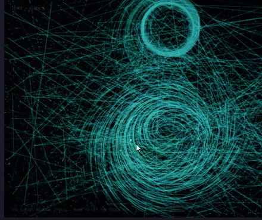

# Levee

> *The survey redraws itself.*

An interactive generative-art piece in a single HTML file: a curl-noise river flows continuously across a dark field, while beneath it a rigid survey grid bends under the current — and snaps back to straight, right-angled lines the moment you stop paying attention.

Built with [p5.js](https://p5js.org/) 1.11.3 (CDN, no build step). Open `river-levee.html` in any browser.



## The idea

River culture vs. road culture, as a playable system. The grid is the coordinate worldview — fixed, orthogonal, certain. The river is the relational one — adaptive, meandering, indifferent to boundaries. The tension isn't staged; it's the mechanic:

- The **river always flows**, whether you're there or not
- Your **cursor bends the survey** — the grid warps under the current while you move
- The moment you **stop, the grid straightens itself** — the institution reasserts its geometry in the absence of attention

A click *cuts a channel*: the flow is scored permanently into the map, and a survey monument is stamped at the incision — the bureaucracy recording the wound.

## Interaction

| Input | Effect |
|-------|--------|
| Move mouse | Bends the amber survey grid under the flow; accelerates the current |
| Stop moving | Grid straightens itself back — flashes as it reasserts |
| Click | Cuts a permanent channel into the map + stamps a survey monument |
| `Space` | Skip the noise field forward — a different river |
| `S` | Save the current frame as PNG |

## How it works

Everything is one file, one canvas, three offscreen buffers:

```
river-levee.html
├── CONFIG / PALETTE      # tuned parameters, designed palette (no raw RGB)
├── setup()               # canvas + bgBuf / trailBuf / scarBuf
├── draw()
│   ├── activity          # cursor velocity → grid bend (eased, 0→1)
│   ├── curlAt(x,y)       # curl of a 3D noise potential → divergence-free flow
│   ├── Particle[] ×2400  # velocity-lerped along the field, drawn as trail segments
│   ├── survey lines      # 25 polylines whose vertices lerp toward curl displacement
│   ├── compose           # bg → grid → scars → trails → sparks (ADD blend)
│   └── captions          # monospace gallery labels
├── mousePressed()        # scores a 620-vertex channel into scarBuf, permanently
└── keyPressed()          # save / reseed
```

Technical notes:

- **Curl noise**: `curlAt()` finite-differences a 3D Perlin potential, giving a divergence-free flow field — particles trace real-looking meanders instead of noisy jitter
- **Three-buffer composition**: the river trail buffer fades by 1 alpha unit per frame (oxbow lakes slowly silt up), while the scar buffer never clears (the map remembers every cut)
- **Seeded**: `randomSeed(2006)` + `noiseSeed(2006)` — the base field is deterministic; your interaction is not
- **Performance**: `pixelDensity(1)`, FES disabled, vectorized draws, `Math.*` in hot paths — holds 60fps at 960×540

## Run it

No dependencies, no build, no server:

```bash
# just open the file
open river-levee.html          # macOS
start river-levee.html         # Windows
xdg-open river-levee.html      # Linux
```

Or serve it if you prefer:

```bash
python -m http.server 8000     # → http://localhost:8000/river-levee.html
```

p5.js loads from cdnjs, so the first render needs network.

## License

MIT
